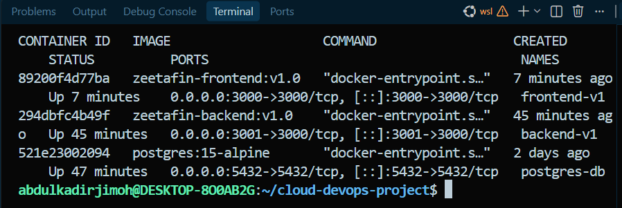
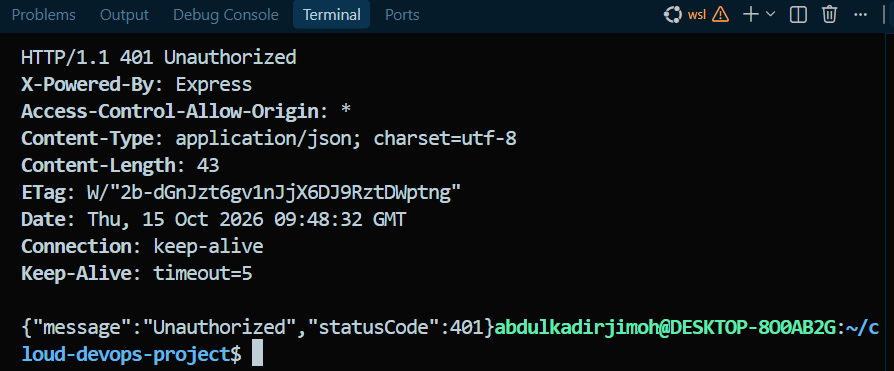
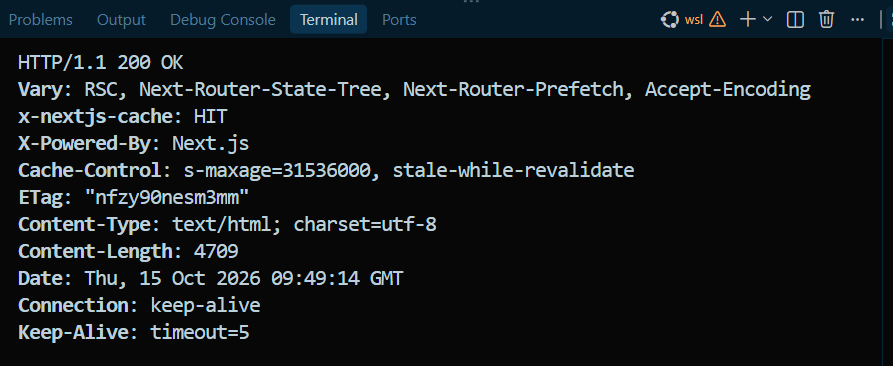
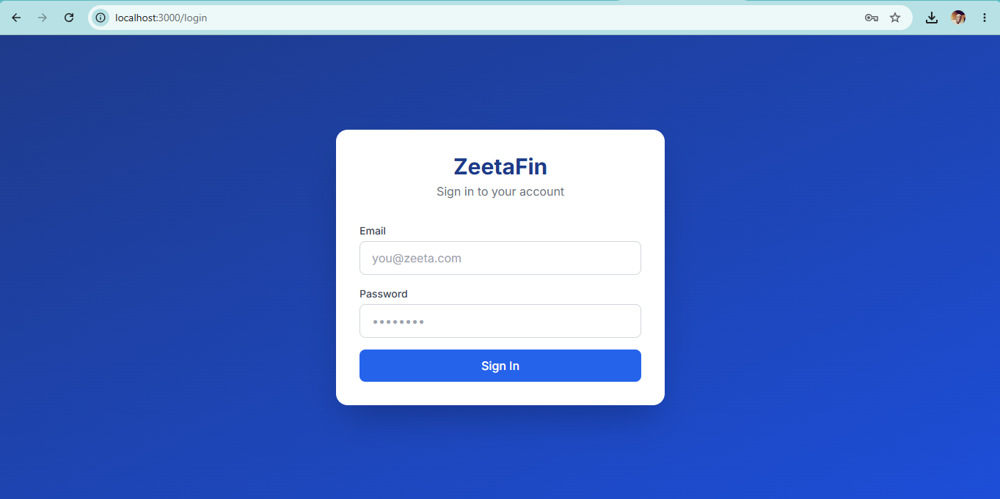
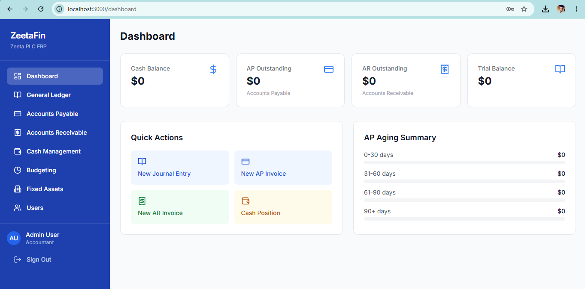
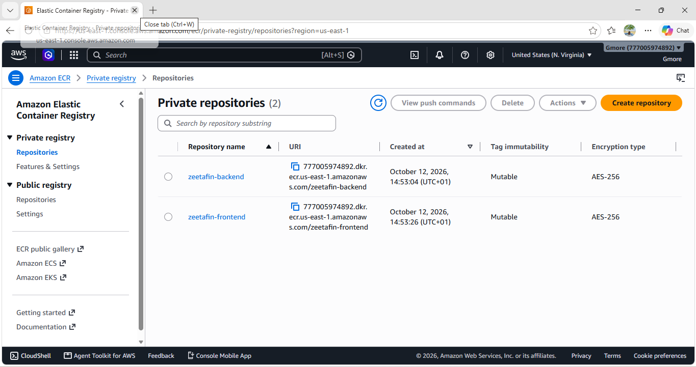
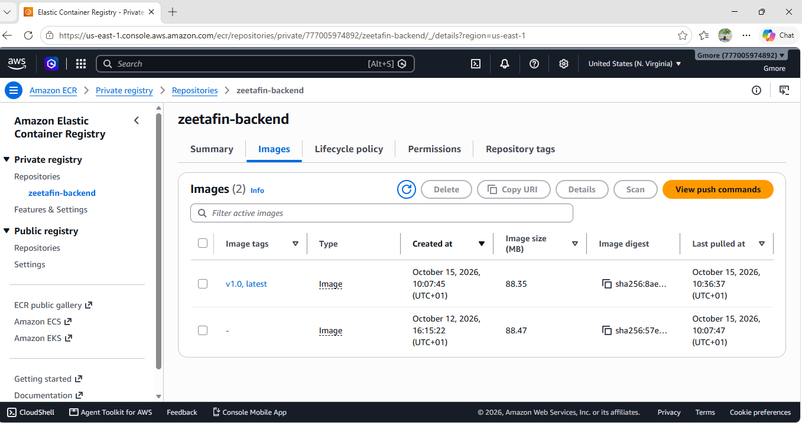
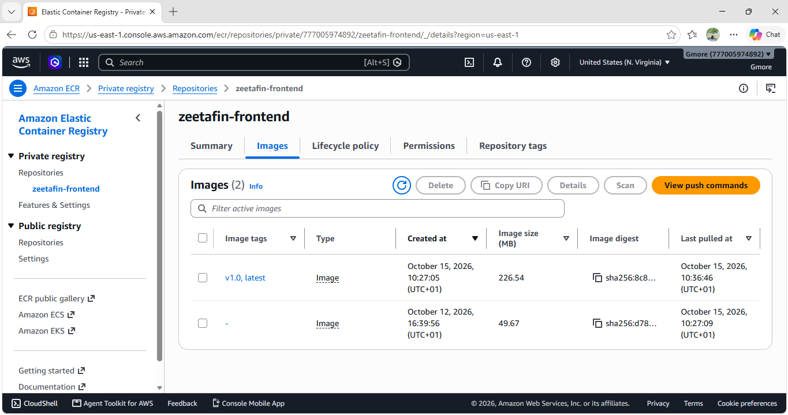
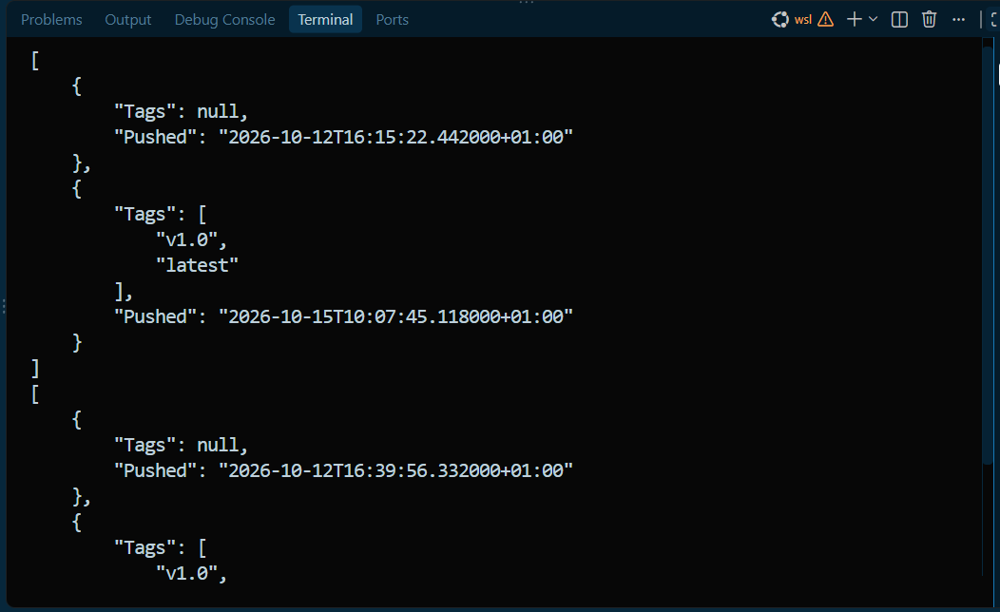
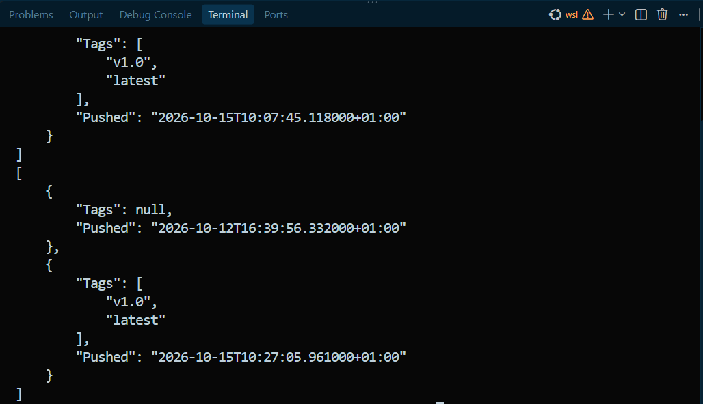

# Phase 2: Application Containerization and Amazon ECR Deployment

## Objective
Containerize the ZeetaFin full-stack application (Next.js & NestJS), test it locally, and push the images to Amazon ECR.

**Flow:** Provided application → Docker container → Docker image → Amazon ECR

## Deliverables & Structure
```
Phase 2 - Containerization and Amazon ECR Deployment/
├── ZeetaFin-BE/            # NestJS backend (Dockerfile, .dockerignore, .env.example)
├── ZeetaFin-FE/            # Next.js frontend (Dockerfile, .dockerignore)
├── docs/screenshots/       # Evidence of local container runs and ECR pushes
└── README.md
```

## Application overview

| | Backend (`ZeetaFin-BE`) | Frontend (`ZeetaFin-FE`) |
|---|---|---|
| Framework | NestJS on Node.js 18 | Next.js 14 (standalone build) |
| Dependencies | `package.json`, `package-lock.json` | `package.json` |
| Port | 3000 in the container (published as 3001 locally) | 3000 |
| Start command | `node dist/main` | `node server.js` |
| Requires | PostgreSQL 15 | Backend API |

Backend environment variables (see `ZeetaFin-BE/.env.example`): `PORT`, `DB_HOST`, `DB_PORT`, `DB_USERNAME`, `DB_PASSWORD`, `DB_NAME`. Real values are never committed; they are supplied at runtime.

> **Note:** the application code in this repository is the compiled output (`dist/` and `.next/`) recovered from the previously built images.

## Dockerfiles
- Base image `node:18-alpine` (pinned version, small footprint)
- Dependencies installed before the application files are copied (layer caching)
- Production dependencies only
- Runs as the non-root `node` user
- npm retry settings added for unreliable networks
- `.dockerignore` excludes `node_modules`, `.env*`, logs and Git data

## Prerequisites
Docker, AWS CLI v2 configured with an IAM user that can use ECR, and a PostgreSQL 15 container or instance.

## Build and run locally
```bash
docker build -t zeetafin-backend:v1.0  ZeetaFin-BE
docker build -t zeetafin-frontend:v1.0 ZeetaFin-FE

docker network create zeetafin-net
docker run -d --name postgres-db --network zeetafin-net -p 5432:5432 \
  --env-file <db-env-file> postgres:15-alpine
docker run -d --name backend-v1  --network zeetafin-net -p 3001:3000 \
  --env-file <backend-env-file> zeetafin-backend:v1.0
docker run -d --name frontend-v1 -p 3000:3000 zeetafin-frontend:v1.0
```

Verify:
```bash
curl -i http://localhost:3001/api/budgeting/budgets   # 401 = API up, auth guard active
curl -I http://localhost:3000                         # 200 = frontend up
```

## Push to Amazon ECR
```bash
ECR=<account-id>.dkr.ecr.us-east-1.amazonaws.com

aws ecr create-repository --repository-name zeetafin-backend  --region us-east-1
aws ecr create-repository --repository-name zeetafin-frontend --region us-east-1
aws ecr get-login-password --region us-east-1 | docker login --username AWS --password-stdin $ECR

docker tag zeetafin-backend:v1.0  $ECR/zeetafin-backend:v1.0
docker tag zeetafin-backend:v1.0  $ECR/zeetafin-backend:latest
docker tag zeetafin-frontend:v1.0 $ECR/zeetafin-frontend:v1.0
docker tag zeetafin-frontend:v1.0 $ECR/zeetafin-frontend:latest

docker push $ECR/zeetafin-backend:v1.0   && docker push $ECR/zeetafin-backend:latest
docker push $ECR/zeetafin-frontend:v1.0  && docker push $ECR/zeetafin-frontend:latest

aws ecr describe-images --repository-name zeetafin-backend  --region us-east-1
aws ecr describe-images --repository-name zeetafin-frontend --region us-east-1
```
Images carry a version tag (`v1.0`) as well as `latest`, so a release can be rolled back.

## Evidence

**Containers running**


**Backend API responding (401: API up, auth guard active)**


**Frontend responding (200)**


**Frontend login page and dashboard**



**Images in Amazon ECR**






## Known issues and improvements
- `npm audit` reports vulnerabilities in the installed dependencies; fixing them needs framework upgrades from source.
- No JWT secret appears in the backend's environment variables, so it is probably hardcoded; it should move to a runtime secret.
- The original TypeScript and React source should replace the recovered build output, with a multi-stage Dockerfile that builds from source.
