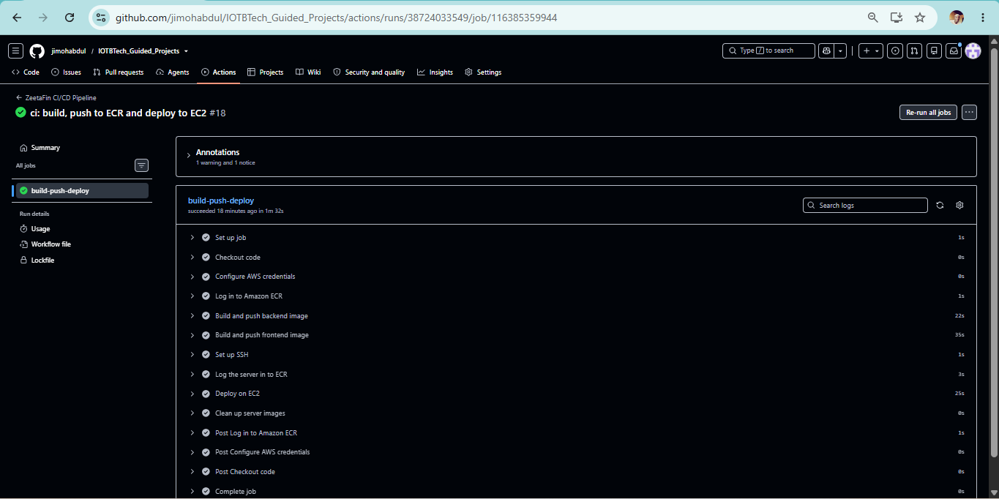
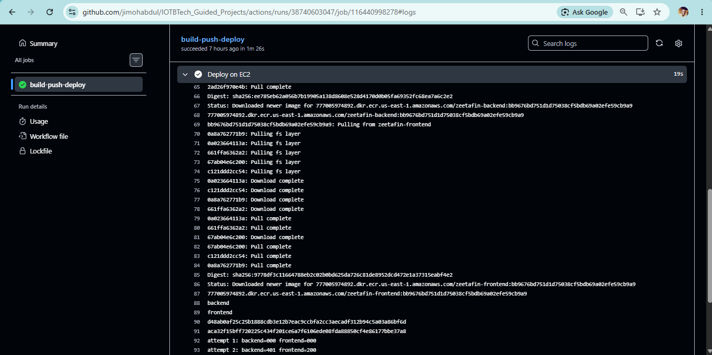
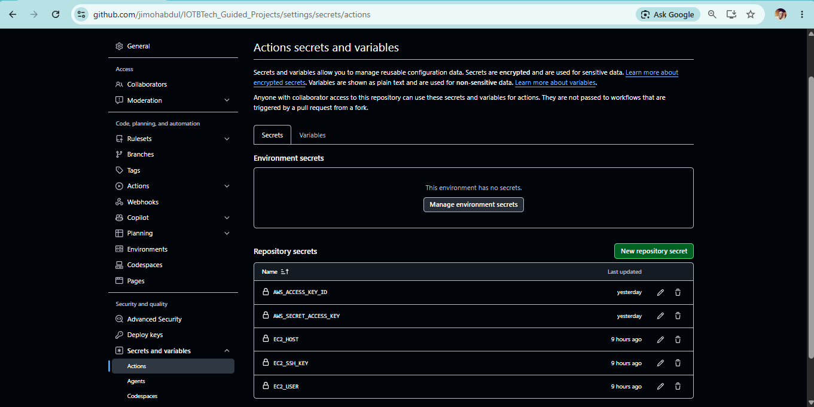
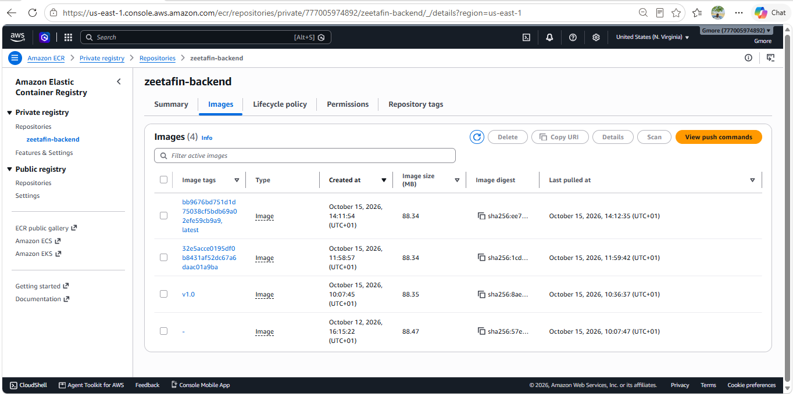
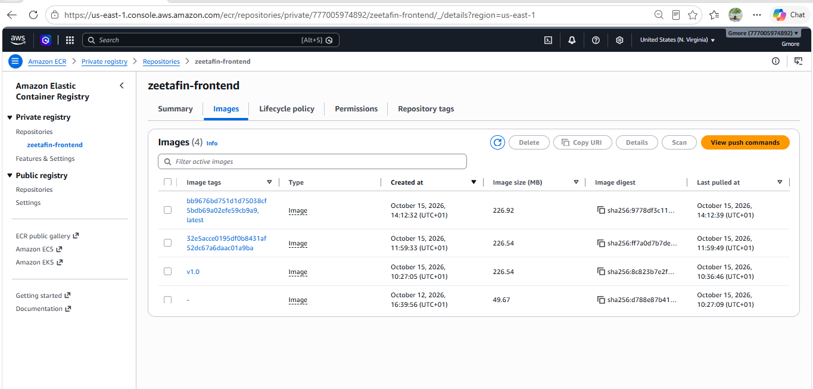
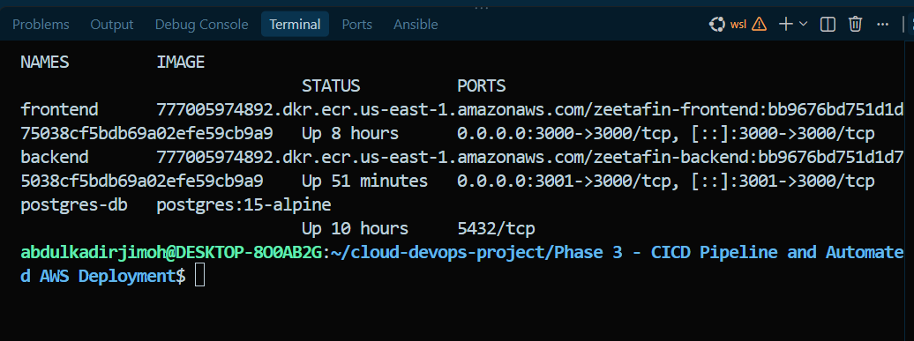
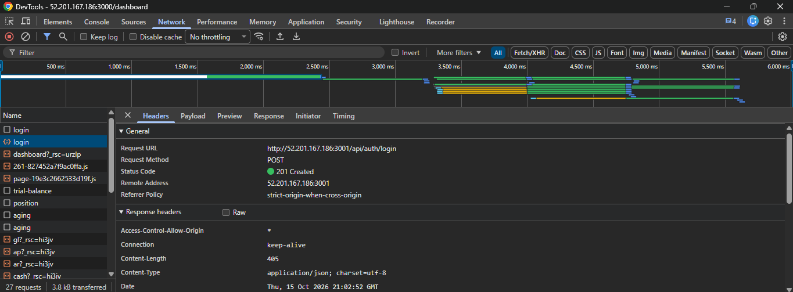
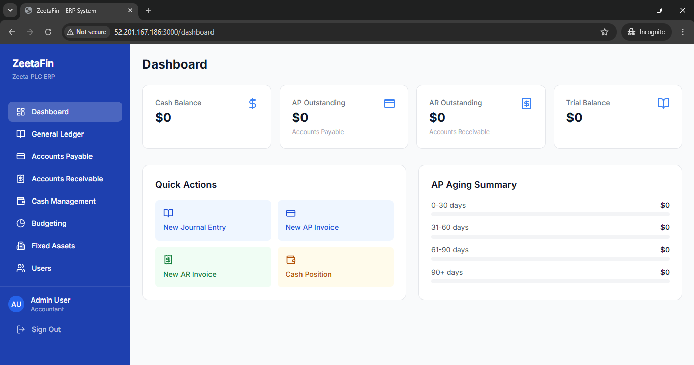

# Phase 3: CI/CD Pipeline for Automated AWS Application Deployment

## Objective
A GitHub Actions pipeline that builds the ZeetaFin Docker images, pushes them to Amazon ECR, and deploys them to the AWS EC2 server from Phase 1 whenever code is pushed to `main`.

**Flow:** Developer pushes code → GitHub → GitHub Actions → build images → push to ECR → EC2 pulls new images → containers restarted → application running

## Architecture

| Component | Detail |
|---|---|
| Repository | GitHub, branch `main` |
| Workflow | `.github/workflows/deploy.yml` |
| Registry | Amazon ECR, `us-east-1` (`zeetafin-backend`, `zeetafin-frontend`) |
| Server | EC2 `t3.micro`, Ubuntu 22.04, Docker installed by Ansible (Phase 1), Elastic IP attached |
| Containers | `frontend` (port 3000), `backend` (port 3001 to container 3000), `postgres-db` (internal only) |

## Pipeline steps
1. **Checkout** the repository.
2. **Authenticate with AWS** using GitHub Secrets.
3. **Log in to ECR.**
4. **Build and push the backend image**, tagged with the commit SHA and `latest`.
5. **Build and push the frontend image**, with the server's backend address passed in as a build argument.
6. **Set up SSH** to the EC2 server using a key stored in GitHub Secrets.
7. **Log the server in to ECR** with a short-lived token sent from the pipeline, so no AWS keys are stored on the server.
8. **Deploy on EC2:** create the Docker network if needed, start Postgres if needed (data in a volume), pull the new images, remove the old `backend` and `frontend` containers, start new ones, then run a health check.
9. **Clean up** unused images on the server.

The deploy fails, and prints the backend logs, if the health check does not pass.

## How the old container is replaced
Each deployment runs `docker rm -f backend frontend` and then starts new containers from the image tagged with the new commit SHA. The database container is left running, so its data survives deployments.

Two real deployments show this:
- Run #18 deployed images tagged `32e5acce...`.
- Run #20 replaced them with images tagged `bb9676bd...` (new tag and new container creation time). The database container was unchanged.

## GitHub Secrets
Credentials are stored as encrypted repository secrets (names only are shown here):

| Secret | Purpose |
|---|---|
| `AWS_ACCESS_KEY_ID` | AWS access for ECR |
| `AWS_SECRET_ACCESS_KEY` | AWS access for ECR |
| `EC2_HOST` | Server address |
| `EC2_USER` | SSH user |
| `EC2_SSH_KEY` | Private SSH key |

Database settings live in `~/zeetafin/.env` on the server (permissions `600`) and are never committed.

## Security practices
- No credentials in the repository; `.env*`, `*.pem`, Terraform state and `inventory.ini` are git-ignored.
- PostgreSQL is not published to the internet; only ports 22 (restricted), 3000 and 3001 are open.
- Images are tagged with the commit SHA so any release can be traced and rolled back.
- Containers run as a non-root user and restart automatically (`--restart unless-stopped`).

## Evidence

**Successful GitHub Actions workflow**

**Deploy step with health check**

**GitHub Secrets (names only)**

**Images in ECR with commit-SHA tags**

**Containers running on EC2**

**Browser calling the deployed backend**

**Application running on AWS**

## Issues encountered and fixes
- **Empty app folders in Git:** the apps had been committed as embedded repositories, so the pipeline had no code to build. Fixed by committing the files directly.
- **Frontend called `localhost:3001`:** the recovered frontend build had the backend address baked in. Fixed by replacing it at image build time with the server address.
- **Empty database on the server:** the new Postgres had no data, so login returned 401. Fixed by restoring a dump from the local database.
- **Lost Terraform state:** the Phase 1 state file was deleted, so Terraform should not be re-applied against the existing server.

## Known improvements
- Use a dedicated least-privilege IAM user, or OIDC, instead of long-lived keys (the current IAM user cannot create roles).
- Use an S3 backend for Terraform state.
- Replace the recovered build output with the original source and a multi-stage Dockerfile.
- Move the JWT secret to a runtime secret, and address `npm audit` findings.
- Put a reverse proxy with HTTPS in front of the application.